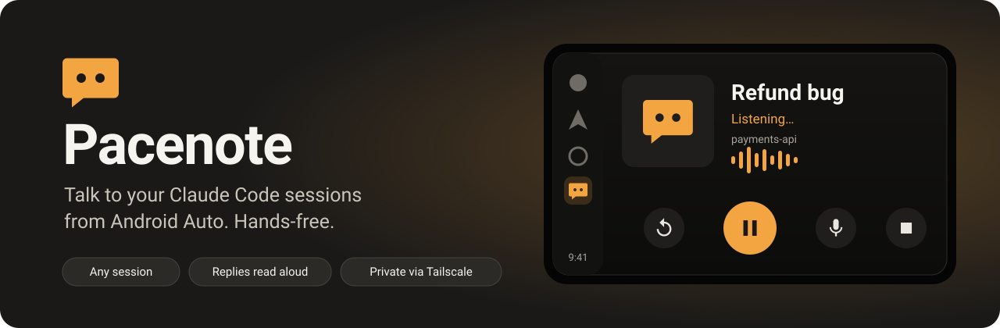
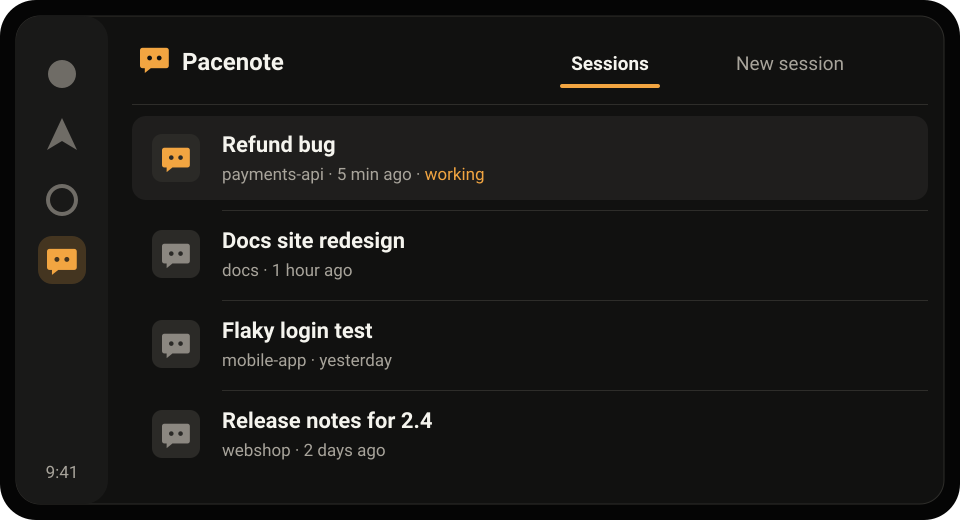
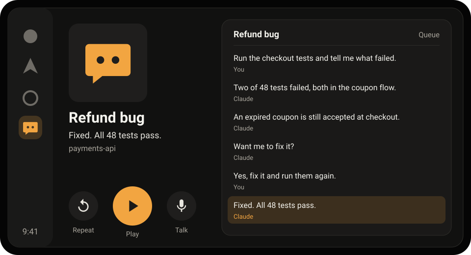
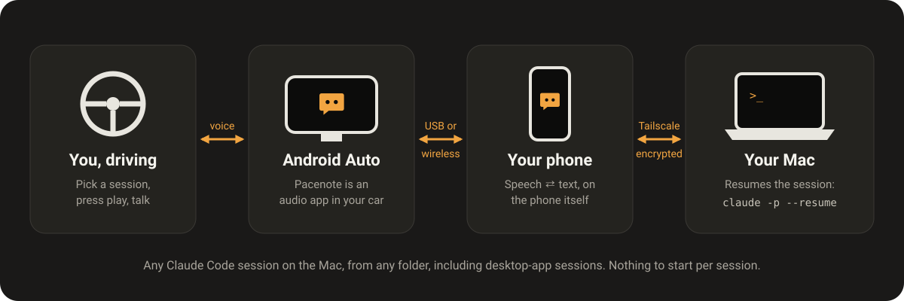
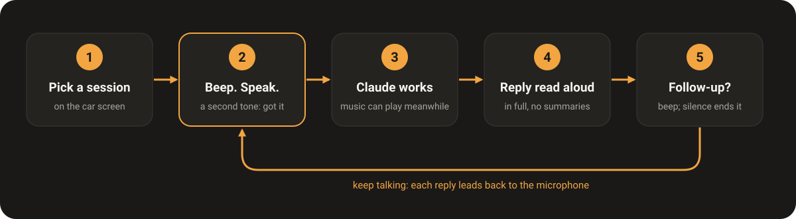
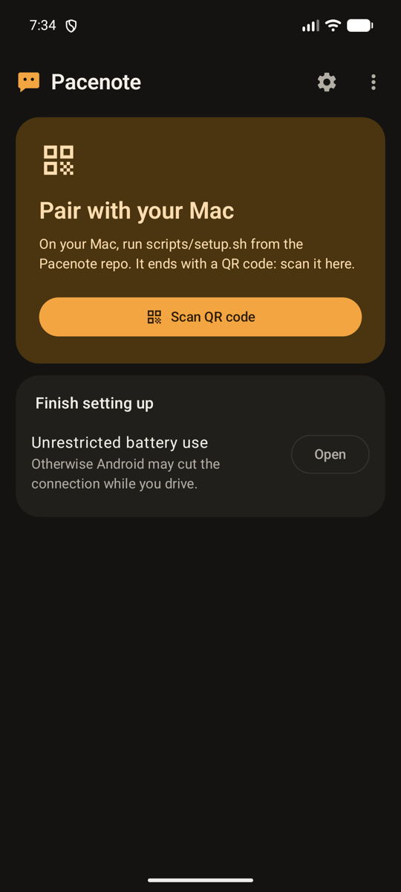
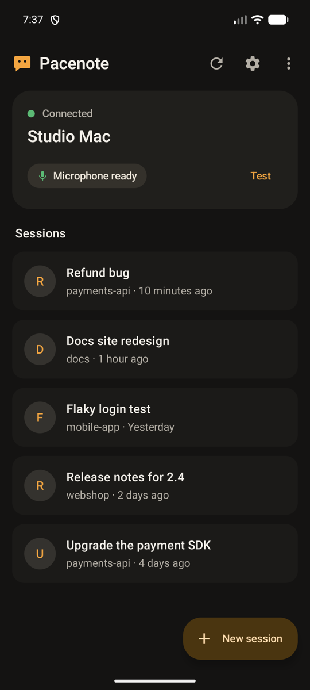
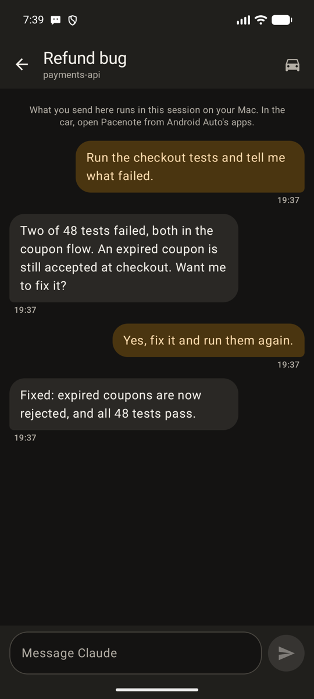

<p align="center">
  
</p>

**Pacenote** lets you talk to the Claude Code sessions on your Mac while you drive. Pick a session on the car's screen, press play, and speak. Claude works on it in that session's folder on your Mac, and reads its reply to you through the car's speakers. Then it listens for your follow-up.

It works with every session on your Mac, from the terminal or the Claude desktop app, in any folder. There's nothing to start per session: a small background service on the Mac resumes whichever one you pick.

> [!NOTE]
> Pacenote is an independent, unofficial project that works with Claude Code. It is not made, endorsed or supported by Anthropic or Google. In rallying, the co-driver reads the pace notes aloud so the driver can keep their eyes on the road; Pacenote does that for Claude.

## Contents

- [What you get](#what-you-get)
- [How it works](#how-it-works)
- [Requirements](#requirements)
- [Install](#install)
- [Use it](#use-it)
- [Settings](#settings)
- [Updating](#updating)
- [Security and privacy](#security-and-privacy)
- [Troubleshooting](#troubleshooting)
- [Limitations](#limitations)
- [Development](#development)

## What you get

- **An audio app in Android Auto.** Pacenote sits next to your music apps. It lists your sessions, and you can start a new one in any folder you've used Claude Code in.
- **A hands-free loop.** Pick a session and speak after the beep. While Claude works, a spinner shows (and your music can play). Its whole reply is read aloud, then it beeps and listens again.
- **Your phone does the speech.** Recognition and reading aloud run on the phone, so Pacenote doesn't depend on Google Assistant or Gemini.
- **Safe with sessions you have open.** If a session is open on the Mac, the car continues in a copy named "… (car)", so two processes never write to one conversation.
- **Built for driving.** Claude is asked to answer in one to three short spoken sentences, without markdown or code, and to tell you before long work.
- **A phone app too.** Browse your sessions, type to one, or start one when you're not driving.

<p align="center">
  
  
  <br><sub>Illustrations of the car screens: your sessions, and a conversation in progress.</sub>
</p>

## How it works

<p align="center">
  
</p>

1. **The car** shows Pacenote as an audio app and plays its sound. Android Auto lets sideloaded audio apps in once you turn on *Unknown sources*.
2. **The phone app** turns your speech into text with the phone's speech recognition. It sends the text to your Mac and reads the replies aloud. It stays connected in the background, so replies reach the car even after a long task.
3. **[Tailscale](https://tailscale.com)** connects the phone to the Mac from anywhere, encrypted. The Mac service listens only on its Tailscale address, and every request needs a secret token.
4. **The Mac service** lists sessions from `~/.claude/projects`. For each message it runs one headless Claude Code turn in that session's folder (`claude -p --resume <session>`) and streams the reply back.

<p align="center">
  
</p>

## Requirements

| | |
|---|---|
| **Mac** | macOS, with [Claude Code](https://docs.anthropic.com/en/docs/claude-code) installed and signed in (`claude` on your PATH), and [Bun](https://bun.sh) |
| **Network** | [Tailscale](https://tailscale.com) on the Mac and the phone, signed in to the same tailnet |
| **Phone** | Android 14 or later, with Android Auto |
| **Car** | Any car or head unit with Android Auto, wired or wireless |

The phone app isn't on Google Play: you install it from [Releases](https://github.com/globulus/pacenote/releases), or build it yourself.

## Install

### 1. The Mac service

```bash
git clone https://github.com/globulus/pacenote.git
cd pacenote
scripts/setup.sh
```

The script:

- creates `~/.pacenote/` with a random 64-character token, plus your Mac's service address (its Tailscale IP, port 8788)
- copies the service there and installs it as a background service (a launchd agent) that starts at login and restarts if it stops
- prints a **pairing QR code** for the phone app. Show it again any time with `scripts/pair.sh`.

> [!IMPORTANT]
> **macOS privacy:** background services can't read `~/Documents`, `~/Desktop` or `~/Downloads` until you allow them. If your projects live there, allow **bun** once:
> 1. If macOS asks whether "bun" may access a folder, click **Allow**.
> 2. If it doesn't ask, open **System Settings → Privacy & Security → Files & Folders** (or **Full Disk Access**) and turn on **bun**. It's usually at `~/.bun/bin/bun`; press Cmd-Shift-G in the file picker to type the path.
>
> Until then, Pacenote tells you that macOS is blocking the folder. Tap **Test** in the phone app to check.

Check the service at any time:

```bash
scripts/service.sh status    # or: restart | stop | start | logs | uninstall
```

### 2. The phone app

**Install the prebuilt app** (easiest):

1. On your phone, download the latest `pacenote-*.apk` from [Releases](https://github.com/globulus/pacenote/releases/latest).
2. Open it and allow the install when Android asks.
3. Open **Pacenote**, tap **Scan QR code**, and scan the code that `scripts/setup.sh` printed.

Pairing only accepts Tailscale addresses, and always asks before it saves one.

<details>
<summary><b>Or build it yourself</b></summary>

You need [Android Studio](https://developer.android.com/studio), or JDK 17+ and the Android SDK (platform 36). Build on the Mac where you ran setup: a debug build includes that Mac's address and token, so it needs no pairing.

```bash
cd android
./gradlew :app:assembleDebug
```

If Gradle can't find Java or the Android SDK, open the `android` folder in Android Studio once. Or set both yourself:

```bash
export JAVA_HOME="/Applications/Android Studio.app/Contents/jbr/Contents/Home"
export ANDROID_HOME="$HOME/Library/Android/sdk"
```

Install it over a cable (turn on USB debugging on the phone):

```bash
adb install -r app/build/outputs/apk/debug/app-debug.apk
```

Or without a cable, with a download link that only works on your tailnet and expires after 20 minutes:

```bash
scripts/publish-app.sh   # builds the app and puts it on the Mac service
scripts/share-apk.sh     # prints the link
```

A debug build contains your token, so don't share it. The prebuilt app contains none.

</details>

On the phone:

1. Open **Pacenote** and allow notifications and the microphone.
2. Under **Finish setting up**, allow unrestricted battery use. Do the same for Tailscale in Android's settings, and set Tailscale to **Always-on VPN**, so the connection survives the phone sleeping.
3. The card at the top should say **Connected** and **Microphone ready**. **Test** checks the connection.

### 3. Android Auto

1. In the Android Auto settings on your phone, tap **Version and permission info** about 10 times. This turns on developer mode.
2. Open the three-dot menu, choose **Developer settings**, and turn on **Unknown sources**.
3. In Android Auto's settings, open **Customize launcher** and make sure **Pacenote** is ticked.

## Use it

### In the car

1. Open **Pacenote** from the car's app list.
2. Pick a session under **Sessions**, or a folder under **New session** to start a fresh one there.
3. It says the session's name, beeps, and listens. Speak; a second tone means it heard you.
4. Claude's reply is read aloud in full. Then it beeps once more and listens for a follow-up; say nothing to stop.

| Control | What it does |
|---|---|
| **Play**, **Talk**, or the steering wheel's *next* button | Talk. This also interrupts any reading. |
| **Pause** | Stop reading or listening. Claude keeps working, and its reply is still read out. |
| **Previous**, or **Repeat** | Read Claude's last reply again. |
| **Stop Claude** (while it works) | Cancel what Claude is doing. You can also just say "stop". |
| **Queue** (list icon) | The conversation, a sentence per row, to read when parked. Tap a row to hear it. |

Things to know:

- **Open the app once after restarting the phone or updating the app.** Android only lets an app use the microphone in the background if it was opened first. If you forget, the car tells you.
- **Permission prompts:** car turns run in Claude Code's **auto** permission mode, since nobody can answer a prompt while you drive. Safe actions go ahead and risky ones are blocked; Claude tells you, and you can do them at the Mac later.
- **Sessions open on the Mac:** if a session is open in the desktop app or a terminal, or was active in the last two minutes, the car continues in a copy named "… (car)". You'll hear "That session is open on your Mac, so I'm continuing in a copy."

### On the phone

<p align="center">
  
  &nbsp;
  
  &nbsp;
  
  <br><sub>The phone app with demo sessions: pairing, your sessions, and a conversation.</sub>
</p>

- Tap a session to read and type to it. The car icon posts it as a message conversation in Android Auto.
- **New session** starts one in a folder you've used Claude Code in before.
- **Settings** has the Mac, voice language, follow-up listening, battery, updates and (under Advanced) the raw address and token.

### Message conversations (optional)

Each session can also appear as a message conversation in Android Auto, from a contact named after the session. You can answer with Android Auto's own voice reply, and a "Pacenote" conversation takes commands such as "list sessions", "open two" and "new session in payments".

This relies on Google Assistant or Gemini taking your reply. With some Google Workspace accounts, Android Auto refuses message replies ("ask your Google Workspace administrator"). The audio app doesn't have this problem.

## Settings

Options for the Mac service. Set them when you run setup:

```bash
PACENOTE_EFFORT=low scripts/setup.sh
```

| Variable | Default | |
|---|---|---|
| `PACENOTE_MODEL` | your Claude Code default | Model for car turns, e.g. `sonnet` |
| `PACENOTE_EFFORT` | your Claude Code default | Effort for car turns; `low` replies faster |
| `PACENOTE_PERMISSION_MODE` | `auto` | Any `--permission-mode` your Claude Code accepts. Actions that would need a prompt are refused, and Claude says so. |
| `PACENOTE_PORT` | `8788` | Port on the Mac's Tailscale address. Pair again after changing it. |

In the phone app, **Speech language** sets what you speak in the car and the language replies are read in (default `en-US`).

## Updating

- **The Mac service:** pull the new code and run `scripts/setup.sh` again.
- **The prebuilt app:** in Pacenote's **Settings**, tap **Update**. It opens [Releases](https://github.com/globulus/pacenote/releases/latest); download the new APK and install it over the old one. Your pairing is kept.
- **A self-built app:** run `scripts/publish-app.sh` on the Mac, then tap **Update** in the app's Settings. It downloads the new build from the Mac over Tailscale, so this works from anywhere. The first time, allow Pacenote to install apps.

After an update, open the app once so the microphone is back on.

## Security and privacy

- **Claude acts without you watching.** Car turns run unattended in auto permission mode. Read what that mode allows, and pick a stricter one with `PACENOTE_PERMISSION_MODE` if you prefer.
- **Only your tailnet can reach the service.** It listens on the Mac's Tailscale address only, never on your local network, and every request needs the token. Plain HTTP is used inside the tailnet because Tailscale's WireGuard tunnel already encrypts it.
- **Anyone with the token can run prompts in your sessions.** Keep `~/.pacenote/token`, the pairing QR code and any APK you built yourself private. The prebuilt APK contains no token. To change the token: delete the file, run `scripts/setup.sh`, then pair again.
- **Pairing can't be hijacked by a link.** The app only pairs with, and only talks plain HTTP to, Tailscale addresses (100.64.0.0/10 and MagicDNS names), and asks before pairing.
- **New sessions start only in known folders,** ones that already have Claude Code sessions.
- **Where your words go:** speech recognition uses your phone's recognition service, which may process audio online depending on your phone. Your messages then go to Claude Code on your Mac, which works as it always does. Pacenote itself sends nothing anywhere else.

## Troubleshooting

| Symptom | What to check |
|---|---|
| Pacenote isn't in the car's app list | Android Auto developer mode and **Unknown sources** are on, and Pacenote is ticked in **Customize launcher**. |
| "The microphone is off" | Open Pacenote on the phone once. This is needed after a restart or an update. |
| **Test** can't reach the Mac | Is Tailscale on and connected, on both the phone and the Mac? Is the Mac awake? Run `scripts/service.sh status`. |
| "That isn't a Pacenote pairing code" | Scan the code from `scripts/pair.sh`. Only Tailscale addresses are accepted. |
| `service.sh logs` says "is Tailscale connected?" | Connect Tailscale on the Mac; the service retries every 10 seconds. |
| "macOS is blocking the car service from that folder" | Allow bun in Privacy & Security (see [The Mac service](#1-the-mac-service)). |
| "That session is open on your Mac, so I'm continuing in a copy" | Expected. Close the session at the Mac if you want the car to continue the original. |
| Replies are slow | `PACENOTE_EFFORT=low scripts/setup.sh`, or a faster `PACENOTE_MODEL`. |
| Replying to a *message* asks you to contact your Workspace administrator | A Google limitation with Workspace accounts. Use the Pacenote audio app instead. |
| Anything else | `scripts/service.sh logs`, and `adb logcat -s PacenoteVoice` for the phone's speech. |

## Limitations

- **The Mac service needs macOS** (it uses launchd). On Linux it would need a systemd unit instead; contributions are welcome.
- **Android only:** there's no CarPlay version.
- **The car screen shows short text.** Android Auto limits text while driving, so replies are spoken; read them in the queue or on the phone when parked.
- **Sideloaded only:** Android Auto needs developer mode and *Unknown sources* to list the app.

## Development

```
bridge/    Mac service (Bun + TypeScript; one small dependency, to print the QR code)
  src/sessions.ts   lists sessions from ~/.claude/projects
  src/runner.ts     runs headless turns (claude -p --resume … --output-format stream-json)
  src/car.ts        routing, copies of open sessions, queueing, hub commands
  src/http.ts       the API (HTTP + server-sent events, bearer token)
  src/pair.ts       the pairing QR code
android/   phone app (Kotlin, Jetpack Compose with Material 3)
  car/              the Android Auto audio app (MediaBrowserService)
  voice/            the spoken conversation: speech recognition, text to speech, tones
  service/, net/    the connection to the Mac (and the microphone)
  notify/           message-conversation notifications
  ui/, update/      phone screens and in-app updates
scripts/   setup (launchd), pairing, service control, smoke tests, publishing and sharing the app
docs/      images for this README
```

```bash
cd bridge && bun test                                 # service tests
cd android && ./gradlew :app:testDebugUnitTest        # app tests, including the voice loop
cd android && ./gradlew :app:connectedDebugAndroidTest  # on a device or emulator: browses the car app
                                                        # like Android Auto (and uninstalls the app after)
scripts/smoke.sh health                               # poke the running service; see the script for more
```

### Releases

The prebuilt APK is a release build: no address or token inside, and signed with the project's key, which is kept outside the repo in `~/.pacenote-release/` (`release.jks` and `signing.properties` with `storeFile`, `storePassword`, `keyAlias` and `keyPassword`). Without that folder, `./gradlew :app:assembleRelease` builds an unsigned APK.

```bash
cd android && ./gradlew :app:assembleRelease
cp app/build/outputs/apk/release/app-release.apk pacenote-0.3.1.apk
gh release create v0.3.1 pacenote-0.3.1.apk
```

To try the car UI without a car, use Google's [Desktop Head Unit](https://developer.android.com/training/cars/testing/dhu): install it with `sdkmanager "extras;google;auto"`, choose **Start head unit server** in Android Auto's developer menu, then run `adb forward tcp:5277 tcp:5277` and `desktop-head-unit --usb`.

## License

[MIT](LICENSE).

Claude and Claude Code are trademarks of Anthropic, PBC. Android and Android Auto are trademarks of Google LLC. This project isn't affiliated with or endorsed by either.
